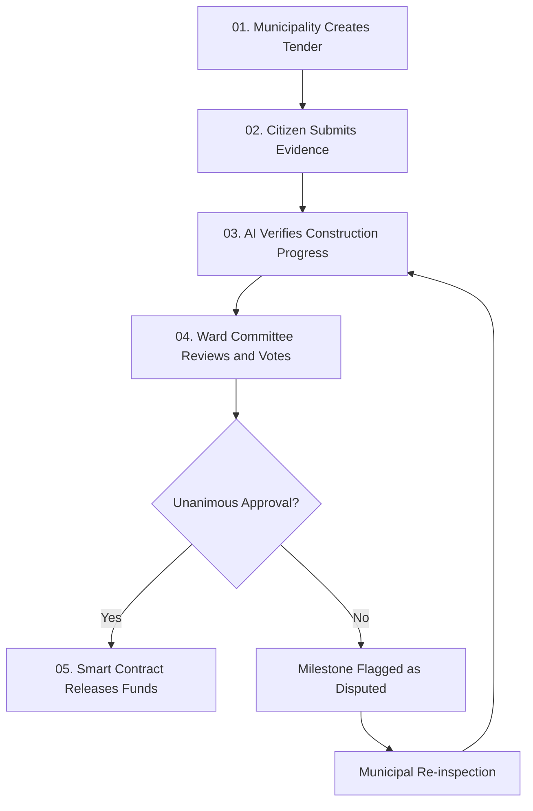
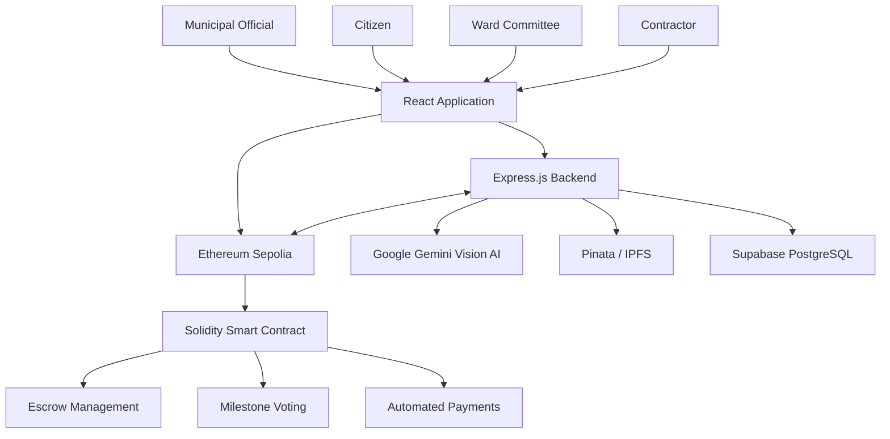

# CivicTrust
### Blockchain-Based Municipal Tender Escrow & Citizen Auditing Platform

**Redefining transparency and accountability in South African municipal infrastructure projects.**

  <strong>Decentralized Accountability. Transparent Funding. Citizen Participation.</strong>

---

## Overview

CivicTrust is a decentralized web application designed to address corruption, financial mismanagement, and the lack of transparency in municipal infrastructure projects.

By combining **blockchain technology, artificial intelligence, and decentralized storage**, CivicTrust introduces a transparent system for managing municipal tender funds, verifying construction progress, and ensuring community participation.

The platform uses Ethereum smart contracts to secure municipal funds in escrow, Google Gemini Vision AI to assess construction progress, and citizen-submitted evidence to support independent project verification.

Funds are released to contractors only after the required verification and approval conditions have been satisfied.

---

## The Problem

Municipalities in South Africa allocate billions of Rands towards infrastructure development, including roads, housing, water systems, and community facilities.

Despite these investments, challenges surrounding corruption, tender fraud, poor service delivery, and limited public oversight continue to affect communities.

CivicTrust addresses six major challenges:

| Challenge | Impact |
|---|---|
| Opaque tender processes | Citizens have limited visibility into how public funds are allocated and spent. |
| Unverified project completion | Contractors can report completed work without independent verification. |
| Financial mismanagement | Funds may be misused or released before construction milestones are completed. |
| Limited citizen participation | Residents lack accessible channels to report construction progress and defects. |
| Weak accountability | Approval processes lack independently verifiable records. |
| Poor audit trails | Traditional records can be altered, lost, or destroyed. |

**The objective:** Create a transparent, tamper-resistant, and citizen-inclusive platform that strengthens accountability in municipal infrastructure development.

---

## The Solution

CivicTrust introduces five interconnected capabilities.

### 01. Blockchain-Based Escrow

Municipal tender funds are deposited into an Ethereum smart contract and secured in escrow.

The budget is divided into predefined construction milestones, such as foundation, walls, roofing, and finishing.

Funds cannot be released until the required verification and approval conditions are met.

### 02. AI-Powered Construction Verification

Google Gemini Vision AI analyzes construction photographs by comparing baseline images with newly submitted citizen evidence.

The AI evaluates:

- Structural integrity
- Materials quality
- Construction completion progress

Each assessment receives an overall score out of 100.

A score below 75% automatically flags the milestone as disputed.

### 03. Citizen Evidence Collection

Residents can access the Citizen Area Scanner without creating an account or connecting a cryptocurrency wallet.

Through the scanner, citizens can:

- Scan their GPS location.
- Discover nearby municipal infrastructure projects.
- Upload construction site photographs.
- Submit observations and feedback.

Submitted photographs are stored on IPFS through Pinata and used during AI verification.

### 04. Ward Committee Approval

Three designated ward committee representatives independently review construction evidence and participate in milestone approval.

CivicTrust implements a **3-of-3 approval mechanism**, requiring unanimous approval before milestone funds can be released.

Every decision is recorded on the Ethereum blockchain, creating a publicly verifiable voting history.

### 05. Public Transparency

Tender information, escrow balances, milestone progress, AI verification results, and voting records are accessible through the platform.

Blockchain transactions can also be independently verified using an Ethereum block explorer.

---

## How It Works

CivicTrust follows a five-stage verification and payment process.

The process ensures that municipal funds remain protected until the required verification and approval conditions are satisfied.

---

## Technology Stack

CivicTrust combines modern web development technologies with blockchain infrastructure and AI services.

| Technology | Purpose |
|---|---|
| React 19 | Frontend application and dashboards |
| Vite | Frontend development and build tooling |
| Tailwind CSS v4 | Responsive interface and styling |
| Solidity 0.8.20 | Smart contract development |
| Ethereum Sepolia | Blockchain network for smart contract deployment |
| MetaMask | Wallet authentication and transaction signing |
| ethers.js v6 | Ethereum blockchain interaction |
| Google Gemini Vision AI | Construction image analysis and verification |
| Pinata / IPFS | Decentralized photograph and report storage |
| Supabase (PostgreSQL) | Application database and metadata management |
| Node.js & Express.js | Backend API and service integration |

---

## System Architecture

CivicTrust follows a hybrid architecture that combines blockchain infrastructure with traditional backend services.

### On-Chain Infrastructure

The Ethereum smart contract manages critical operations that require transparency and tamper-resistant execution:

- Municipal tender creation.
- Escrow fund management.
- Construction milestone management.
- Ward committee voting.
- Automated contractor payments.
- Role-based access control.

### Off-Chain Infrastructure

**Express.js Backend**

Coordinates communication between the frontend, AI services, decentralized storage, database, and blockchain.

Responsibilities include:
- Citizen evidence submissions.
- Gemini AI verification requests.
- IPFS file uploads.
- Blockchain-to-database synchronization.
- GPS-based tender discovery.

**Supabase (PostgreSQL)**

Stores and manages application data, including:
- Tender metadata.
- Citizen evidence records.
- AI verification reports.
- Activity logs.
- Application-related information.

**Pinata / IPFS**

Provides decentralized storage for:
- Baseline construction photographs.
- Citizen-submitted evidence.
- AI verification reports.

Each uploaded file receives a unique Content Identifier (CID).

### Architecture Diagram

---

## User Roles & Access Control

CivicTrust provides dedicated interfaces and permissions for each participant.

| User Role | Responsibilities |
|---|---|
| Municipal Official | Creates tenders, allocates escrow funds, manages contractors, and monitors projects. |
| Contractor | Views assigned projects, milestone progress, AI scores, and payment information. |
| Ward Committee Representative | Reviews construction evidence and approves or rejects milestones. |
| Citizen / Resident | Discovers nearby projects and submits construction photographs and observations. |

### Authentication Model

- Municipal officials authenticate using authorized MetaMask wallets.
- Contractors authenticate using their assigned wallet addresses.
- Ward committee representatives authenticate through authorized wallets.
- Citizens access the evidence submission interface without wallet authentication.

Access to administrative and approval functions is restricted according to the user's authorized role.

---

## Key Features

| Feature | Description |
|---|---|
| Smart Contract Escrow | Secures municipal tender funds until approval conditions are satisfied. |
| Milestone Payments | Divides project budgets into predefined construction stages. |
| AI Verification | Analyses construction photographs using Gemini Vision AI. |
| GPS-Based Discovery | Identifies nearby municipal infrastructure projects. |
| Citizen Reporting | Allows residents to submit photographs and observations. |
| Decentralized Storage | Stores project evidence and AI reports using IPFS. |
| Multisignature Approval | Requires unanimous approval from three ward representatives. |
| Automated Payments | Releases milestone funds through smart contract execution. |
| Role-Based Dashboards | Provides dedicated interfaces for different platform participants. |
| Transparent Audit Trail | Maintains verifiable records of project activities and decisions. |

---

## Demonstration Scenario

**Use Case: Ward 14 Gravel Road Repair — City of Johannesburg**

The following scenario demonstrates the complete CivicTrust workflow.

**Stage 1 — Tender Creation**

A municipal official connects their MetaMask wallet and creates a tender for a gravel road repair project. The project budget is deposited into the Ethereum smart contract and divided into construction milestones.

**Stage 2 — Citizen Participation**

Residents near the construction site access the Citizen Area Scanner, locate the project using GPS, and submit photographs documenting construction progress.

**Stage 3 — AI Verification**

Gemini Vision AI compares the submitted photographs against the original baseline images and generates a construction assessment.

**Stage 4 — Community Approval**

Three ward committee representatives review the submitted evidence, AI assessment, and project progress before casting their votes.

**Stage 5 — Automated Payment**

Once all three representatives approve the milestone, the smart contract automatically releases the corresponding payment to the contractor.

The transaction and approval history remain publicly verifiable on the blockchain.

---

## Security & Accountability

CivicTrust incorporates several mechanisms to strengthen trust and accountability:

- **Smart Contract Enforcement:** Predefined escrow conditions govern the release of funds.
- **Wallet Authentication:** Blockchain wallets authenticate authorized participants.
- **Immutable Voting Records:** Committee decisions are permanently recorded on-chain.
- **Decentralized Evidence Storage:** IPFS content identifiers support independent file integrity verification.
- **Multi-Party Approval:** No single ward committee representative can independently authorize a milestone payment.
- **Role-Based Permissions:** Administrative and approval operations are restricted to authorized participants.

---

## Future Improvements

Potential enhancements for a production deployment include:

- Integration with a decentralized oracle network.
- Deployment to a production blockchain network or Layer 2 solution.
- Enhanced AI verification and fraud detection.
- Progressive Web App (PWA) support.
- Advanced municipal analytics and reporting.
- Improved evidence validation and location verification.
- Expanded citizen feedback and community engagement.

---

## Project Status

**Current Stage:** Prototype / Demonstration

CivicTrust currently uses the Ethereum Sepolia test network for smart contract deployment and testing.

The platform demonstrates how blockchain, artificial intelligence, decentralized storage, and citizen participation can be integrated to improve municipal accountability.

It is a prototype and is not yet intended for production municipal financial operations.

---

## Project Vision

> **Public money deserves public accountability.**

CivicTrust aims to bridge the gap between municipalities and the communities they serve by making infrastructure development more transparent, verifiable, and inclusive.

By combining blockchain-based financial accountability, AI-powered construction verification, and direct citizen participation, CivicTrust introduces a new approach to monitoring public infrastructure projects in South Africa.

---

**CivicTrust — Building trust through technology.**
